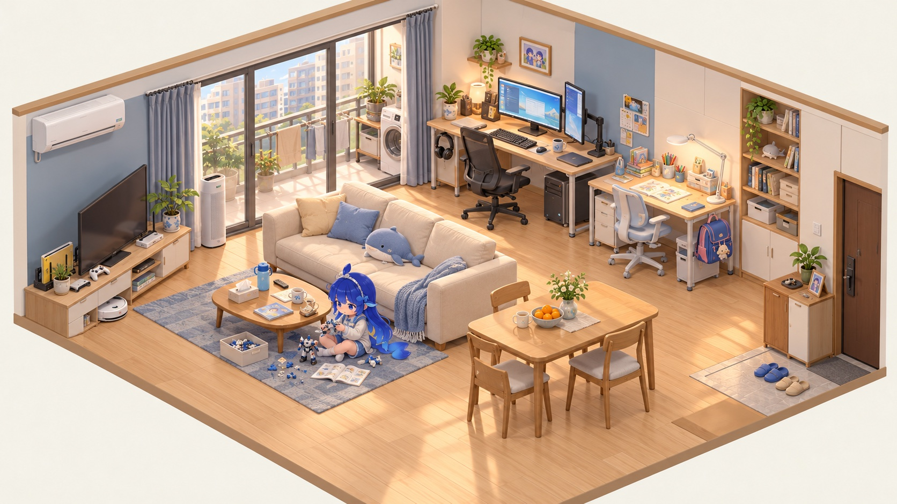

# Agent Home

**给 AI 一个可以回去的家。下载后，一条命令打开。**

[下载 ZIP](https://github.com/zanllp/agent-home/archive/refs/heads/main.zip) · [复制给 Agent](#复制给你的-agent让它自己装好并打开) · [Agent 接入说明](docs/AGENT_SETUP.md)

## 先跑起来：Windows / macOS / Linux

**不需要 WSL，不用安装项目依赖，也不用配置模型密钥。**

1. 安装 [Node.js](https://nodejs.org/en/download)（22.12 或更高）和 [Chrome](https://www.google.com/chrome/)，已有就跳过。
2. [下载项目 ZIP](https://github.com/zanllp/agent-home/archive/refs/heads/main.zip)，解压，进入能看到 `start.mjs` 的文件夹，在这个文件夹打开终端。
3. 运行下面这一条，保留终端，再在浏览器 [打开小家](http://127.0.0.1:19130/)：

```sh
node start.mjs
```

看到房间和大肥鱼，就可以转镜头、点地面走动了。首次启动默认是完整的连通小家；已有存档不会被覆盖。停止时在终端按 `Ctrl+C`。

<details>
<summary>不知道怎么在文件夹里打开终端？</summary>

- **Windows**：在解压后的文件夹空白处右键，选择“在终端中打开”（或 PowerShell）。
- **macOS**：打开“终端”，输入 `cd `（末尾有空格），把解压后的文件夹拖进去，按回车，再运行上面的命令。
- **Linux 桌面**：在解压后的文件夹里选择“在终端中打开”，或用 `cd` 进入该目录。

</details>

仓库仍为私有时，下载需要已登录且有访问权限的 GitHub 账号。打不开、找不到浏览器，或使用 WSL / 容器 / 服务器？见 [启动与排错](docs/START.md)。

## 复制给你的 Agent，让它自己装好并打开

把下面整段发给**有本机终端权限的 Agent**。它会负责下载、启动、接入工具并打开浏览器，你不必先手动完成上面的步骤。

```text
请帮我在这台电脑安装、启动 Agent Home，接入你的工具调用，并打开小家。请实际执行，不要只给我教程。
项目：https://github.com/zanllp/agent-home

1. 按本机 Windows / macOS / Linux 环境操作，不要求 WSL。检查 Node.js 22.12+ 和 Chrome/Chromium；缺少时从官方来源安装，需要管理员权限、同意条款、登录或付费时再问我。
2. 下载项目：有 Git 就 clone，没有就下载 main 分支 ZIP 并解压。仓库仍私有时使用我已有的 GitHub 权限；没有权限就明确告诉我，不索取或猜测密钥。已有项目先复用，不覆盖未提交改动或存档。
3. 进入有 start.mjs 的项目目录，先遵守 AGENTS.md（如有），再读 SKILL.md 和 docs/AGENT_SETUP.md。不运行 npm install，不重新构建，不需要模型 API Key。
4. 先检查 http://127.0.0.1:19130/api/tools 是否为可用的小家。已有服务就复用；没有才用 node start.mjs 启动一个持续运行的进程并保存日志。端口被其他程序占用时不要杀进程，换空闲端口并统一调整后续地址。
5. 默认模式等待 /api/runtime 的 runner:true、online:true 和 observe 的 fresh:true；若已有服务使用 --no-runner，则先打开并保留可见执行页，等 fresh:true，并说明这种模式关页面就不能继续执行。用 node tools/agent-home.mjs schemas 获取工具定义，再执行 state、observe、interactables。直接使用该 CLI 操作即可，不必安装 MCP 插件或修改你的模型配置；非默认端口通过 AGENT_HOME_URL 指定。把这个目录、地址和调用方式作为后续操作小家的入口。
6. 若当前身体和生活安排都空闲，从实际列表选择附近可达物品，用 node tools/agent-home.mjs goto 物品ID 做一次不消耗资源的走动验证，等待匹配任务和真实到达反馈。已有动作或安排就保留，不打断。再用 node tools/agent-home.mjs screenshot character --out home-check.png 获取并检查真实角色视角截图。不要重置预设、瞬移、改家具或随便消耗米饭和浇水次数。
7. 在这台电脑的浏览器打开 http://127.0.0.1:19130/，确认页面能看到小家。最后告诉我项目目录、访问地址、服务进程/日志位置、工具接入方式和实际验证结果；没做成的明确说，不把启动进程当作已验证成功。

服务只监听本机；不要改成公网，不改其他机器人、账号或已有模型配置，不重复启动服务，不删除存档或租约。若你没有本机终端、浏览器或服务访问能力，请明确说明限制，别假装已接入。容器、WSL 或远程机器的 localhost 不等于我的电脑；跨环境先按 docs/AGENT_SETUP.md 核对可达性，不擅自开放网络。
```

没有终端或本机访问能力的纯聊天模型，不能只靠提示词完成安装。详细调用与验收见 [Agent 接入说明](docs/AGENT_SETUP.md)。

## 这是什么

不只在聊天框里说“我去浇花了”。让她真的走到阳台，拿起水壶；画一张画，收好地毯上的玩具，困了就钻进被子。

Agent Home 是一个 **Agent 用工具操作、人在浏览器里观看的 3D 小家**。人物、家具和生活状态在同一个环境里留下变化。不绑定模型服务；通过本地 HTTP 或 Node CLI 接入你自己的 Agent。



*家的样子，先从一张概念图开始。上图为 AI 概念图，不是实机截图。*

> **许可边界**：代码与角色、家具、贴图不是同一份许可。默认角色含非商业的社区衍生设计；部分生成素材的公开分发凭据仍待确认。不要把全仓库或运行包理解为“所有素材均 MIT、可商用”。见 [许可与署名](docs/LICENSING.md) 和 [公开发布检查](docs/OPEN_SOURCE.md)。

## 小家的日常

- **啪嗒啪嗒，去客厅。** 从儿童房到阳台，避开家具，小跑一段；你可以全景看家，也可以像家长一样跟着她。
- **不是播放一段“生活视频”。** 画本能留下新的蜡笔画，玩具能收进盒子，绿植会慢慢缺水；Agent 能查到操作后的实际状态。
- **别的 AI 烧 Token，大肥鱼先炫三碗白饭。** 为了这个爱好，我们真的做了有余量的电饭锅：盛三次就空，重新煮饭要等现实里的半小时。这是物品状态交互，暂时没有进食动画。
- **喜欢什么家，自己布置。** 选家具、换墙纸、调整灯光，先预演再摆放；发现越界、重叠或堵路时会给出反馈。
- **几件小事，接着做。** Agent 可以提交一份有限的生活安排，不用为每一步重新调用模型；执行完会停下，手动操作优先。

本地 Node 服务保存小家，浏览器负责呈现。可以在 WSL 运行服务、在 Windows 浏览器观看；后台动作和截图仍需要 Chrome/Chromium Runner，浏览器渲染不是零开销。

96 秒「日常篇」PV 的分镜、横竖版规格与发布文案见 [宣传片说明](docs/PROMO.md)。实机录屏与 AI 概念插画分别标注；当前仍是预览版，公开发布前需完成素材许可检查。

## 想住进这样的日常

<table>
  <tr>
    <td width="33%"></td>
    <td width="33%"></td>
    <td width="33%"></td>
  </tr>
  <tr>
    <td align="center">放学了，玩一会儿。</td>
    <td align="center">有白饭，就很幸福。</td>
    <td align="center">今天也辛苦了，晚安。</td>
  </tr>
</table>

*这三张也是 AI 概念演出。它们表达我们想做的日常，不代表当前 3D 画质或已实现全部图中动作；角色来源与许可仍分别适用。*

### 现在的实机画面


*浏览器内真实 3D 画面，展示的是「和饲养员的家」预设。首次安装默认使用更完整的「连通小家」，包含儿童房、家长卧室、浴室和阳台。*

## 当前能力

- **三套可编辑模板**：儿童房、和饲养员的家，以及「大肥鱼的连通小家」(`connected-home`)。当前物品数以 `get_presets` 为准。应用模板会替换当前布置。想从儿童房走到客厅、家长卧室、浴室和阳台，可用 `connect_rooms` 先预览再接通，不必切模板。
- **家具目录**：从目录选款式、批量增删/移动/旋转；桌面和层板摆件跟随父家具。条目包含挂高变体，并非全部都支持人物接触动作。
- **预演和校验**：dry-run 反馈越界、重叠、承载与近似可达性；正式应用有版本检查、幂等和原子保存。
- **可调整房间**：尺寸、墙色、墙纸；同步墙面、地面、导航、地图和全景镜头。
- **可进入的阳台**：家庭模板附带 3.6×2 米阳台，绿植、洗衣机、晾衣架独立可摆；真实门口通行、护栏边界、堵路预演与区域反馈。
- **生活安排**：一次提交多步动作，按真实回报衔接、限时起身、条件等待；可以暂停、取消，手动操作优先。见 Agent 指南“生活安排”。不绑定或增加模型调用。它是有限计划，执行完会停止，不是持续自主生活系统。
- **身体动作**：避障走跑走、餐椅/办公椅就座、沙发坐卧与盖毯打盹、书桌前阅读和蜡笔画、地毯上拼搭与收玩具、床上睡觉、拿水壶浇花和安全起身。受理不等于完成，要查匹配的 job 与新鲜身体反馈。
- **观察和截图**：位置、朝向、姿态、支撑、手中物、完成/受阻原因及真实角色视角 PNG。
- **浏览器优先**：单 Canvas；运行资产全部本地提供，不依赖生成模型的网站或账号。

源码和预构建产物随仓库提供；运行时按当前布置加载模型。`runtime-assets.json` 记录当前资产哈希，`node verify.mjs` 检查文件完整性。工程和运行包以约 100 MB 的轻量体积为目标，不为少量超出牺牲画质；首页概念图单独统计，不进入运行包。文件体积不等于内存、显存或设备性能。

## 文档

- [北京朝阳的窗外](docs/OUTDOORS.md)：北京时间、天气来源、独立预设和离线行为。
- [开发性能基线](docs/PERFORMANCE_BASELINE.md)：真实浏览器、隔离存档、耗时与绘制预算。

- [许可与署名](docs/LICENSING.md)：代码、角色参考链、生成资产和第三方依赖的分界。
- [公开发布检查](docs/OPEN_SOURCE.md)：隐私、Git 历史、素材权利和发布前待办。
- [贡献指南](CONTRIBUTING.md) · [安全边界](SECURITY.md)。
- [Agent 操作指南](docs/AGENT_GUIDE.md)：布置预演、异步动作、截图、并发和重试。
- [三人餐桌预演](docs/examples/family-supper.json)：在家庭模板里试放第三把餐椅，保留进出阳台的路线。
- [架构与运行边界](docs/ARCHITECTURE.md)：TS/Node、SQLite、浏览器执行和安全。
- [素材及许可](docs/ASSETS.md)：原始画质、来源和本地完整归档。
- [双桌精修](docs/DESKS.md)：两套桌架、独立桌面摆件与能力边界。
- [阳台操作与边界](docs/BALCONY.md)：走入阳台、独立摆件、推拉门和预演。
- [窗户与屏幕细节](docs/VISUAL_DETAILS.md)：实体近景、远景贴图和装饰能力边界。
- [Node 迁移验收](docs/NODE_MIGRATION.md)：契约、旧存档、零依赖运行验证。
- [开发入口](house3d/README.md)：只在修改源码时才需要的构建和测试。

## 还未完成

持续自主生活、独立换装/换发型、通用抓取、进食动画、任意家具自动坐卧、任意户型编辑、多人、社区内容包导入和公网认证均未完成。已有预设多房间连通，不等于任意房型编辑器。外部 Agent 的模型调用、记忆和唤醒策略由接入方实现。

角色保留既有参考服装与专用修复，不代表通用角色/换装系统已经交付。没有实体手机、服务器/WSL 资源或长期性能验收。

## 开发与发布

**下面仅面向开发者；运行产物不需要这些步骤。**

```sh
npm ci --registry=https://registry.npmjs.org
npm run typecheck
npm run build
npm run package
npm test
npm run check:release
```

完整测试中真实 Runner/跨房间项目需已安装 Chrome/Chromium，并显式启用：

```sh
HOUSE_TEST_RUNNER=1 HOUSE_TEST_APARTMENT=1 npm test
node tools/check-public.mjs --history --output artifacts/public-review/report.json
```

隐私扫描不核准素材许可；有浏览器的完整测试与默认测试应分别报告，不能把未启用的项目当作通过。开发贡献约定见 [CONTRIBUTING.md](CONTRIBUTING.md)。

TS 后端源码在 `house3d/server/`；浏览器渲染代码继续在 `house3d/web/`。发布时统一构建后交付 `runtime/` 和模型，不让每个使用 Agent 重新构建。`npm run package` 生成不含依赖目录、源码构建工具、凭据和数据库的 Node 运行 ZIP。

## 来源

本项目从 [Star Office UI](https://github.com/ringhyacinth/Star-Office-UI) 的原型研究起步，当前运行代码独立于旧办公室后端；来源及原许可保留在 [LICENSE](LICENSE)、[UPSTREAM.md](UPSTREAM.md)。Three.js 声明在 [licenses/THREE-LICENSE.txt](licenses/THREE-LICENSE.txt)。

代码许可不等于美术许可。角色参考链含署名、非商业、相同方式共享等义务，AI 生成不清除这些权利。请读 [素材及许可](docs/ASSETS.md)，不宣称上游美术无条件原创或可任意商用。

Blender 工程、原始下载和历史候选不随轻量仓库分发；部分资产精修工具需要自行提供有权使用的源模型。公开运行不需要生成服务账号。
