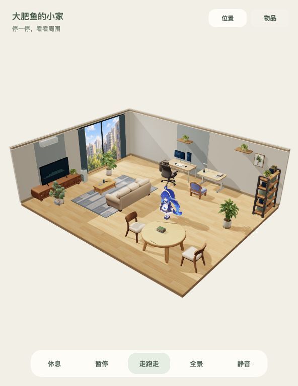

# Agent Home

**一个由 Agent 操作、人在浏览器里观看的 3D 小家。**

Agent 不只是向看板上报“正在工作”，而是可以在家里走动、坐下读书、上床睡觉、选择家具和墙纸、调整房间尺寸，再通过位置/朝向、动作结果和角色视角图片了解发生了什么。浏览器负责呈现，工具负责操作；不绑定某一家模型。

目前是本地可运行原型，默认住户是虚构的十岁角色“大肥鱼”。不是完整生活模拟器，也不是已经上线的多角色平台。



## 现在能做什么

- **两套布置模板**：儿童房（6 × 5 米）、和饲养员的家（8 × 6.5 米）；选择后可继续由 Agent 调整。
- **布置工具**：目录里选择家具；批量添加、移动、旋转、移除；桌面/壁架摆件跟随承载家具。
- **先预演再应用**：`dry_run` 返回越界、重叠、承载和近似可达性报告；正式应用有版本检查、幂等和原子保存。
- **房间可调整**：宽、深、高、墙面颜色与墙纸；尺寸同步墙体、地面、寻路、地图和全景镜头。
- **身体与生活动作**：避障走动、长距离走跑走；已声明支持的椅/沙发坐姿、椅读书、床上睡觉和安全起身。
- **Agent 反馈**：位置、朝向、姿态、支撑物、手中物品、动作进行/完成/受阻；可请求角色视角或旁观镜头 PNG。
- **跨端观看**：单 Canvas 页面，Three.js / WebGL；鼠标、触摸及 Canvas 内控制。已做浏览器验证，不宣称所有实体设备性能都已验收。
- **离线持久化**：SQLite 保存状态，不需要模型账号、Tripo 登录或 DSH 才能运行。

轻量仓库约 60 MB，运行模型和贴图与完整本机工程逐文件 SHA256 相同，没有减面、缩图或重编码。家庭模板实际用到的模型/贴图约 33 MB，其余家具按需要加载。完整建模工程、历史候选与旧 2D 原型保留在本机相邻 `dafeiyu-home`，不进入这个 GitHub 仓库。

当前目录提供 52 个家具资产条目，其中部分是同模型的挂高变体；这不等于 52 件家具均已验证人物接触动作。可用动作必须读取 `list_objects`，不能靠名字推断。

## 快速运行

需要 **Python 3.10+、Node.js 22.12+ 和 npm**。运行已经导出的模型不需要 Blender。

```sh
git clone https://github.com/zanllp/agent-home.git
cd agent-home
python3 -m venv .venv
.venv/bin/python -m pip install -r house3d/requirements.txt
npm --prefix house3d ci
npm --prefix house3d run build
.venv/bin/python house3d/server.py
```

打开 **http://127.0.0.1:19130/wander.html**。

- 私有仓库需先配置自己的 GitHub 访问权限。
- 首次启动创建本地数据库和基础儿童房；选择家庭版见下方。不会提交或上传你的运行数据库。
- 服务默认只监听本机。先确认端口没有旧实例，不要启动副本。
- `/` 与 `/wander.html` 都进入当前生活画布；旧结构/动作对比页面只在完整本机工程保留。

## 让 Agent 开始操作

在项目根目录运行，CLI 默认访问 19130：

```sh
.venv/bin/python house3d/agent.py get_tools
.venv/bin/python house3d/agent.py get_catalog
.venv/bin/python house3d/agent.py get_presets
.venv/bin/python house3d/agent.py observe_home

# 切换模板会替换当前布置，先预演
.venv/bin/python house3d/agent.py apply_preset '{"preset_id":"family-home","dry_run":true}'
.venv/bin/python house3d/agent.py apply_preset '{"preset_id":"family-home","dry_run":false}'
```

也可以直接读取 `GET /api/tool-schemas`，把 function schemas 接到任意支持工具调用的 Agent，再将调用转发给本地 CLI 或 HTTP。**这是受控家居操作接口，不是执行任意 shell 的接口。**

完整工具流程、异步动作和错误处理见 [Agent 操作指南](docs/AGENT_GUIDE.md)。首次干净安装验收见 [交付检查](docs/RELEASE_CHECK.md)。

## 文档导航

| 文档 | 内容 |
|---|---|
| [Agent 操作指南](docs/AGENT_GUIDE.md) | 工具发现、布置预演、动作反馈、截图、版本和幂等 |
| [架构与边界](docs/ARCHITECTURE.md) | 状态、浏览器执行、持久化、安全与资源边界 |
| [素材与许可](docs/ASSETS.md) | 角色/家具来源、可编辑模型、上传与分发限制 |
| [开发入口](house3d/README.md) | 构建、测试、代码位置 |
| [轻量交付检查](docs/RELEASE_CHECK.md) | 体积、资产逐字节一致与干净安装验证 |
| [开发 Agent 约定](AGENTS.md) | 在仓库内继续修改时的约束 |

## 验证

```sh
.venv/bin/python -m unittest discover -s house3d -p 'test_*.py'
(cd house3d && node --test test_*.mjs)
npm --prefix house3d run build
```

完整本机工程的基线为 103 项 Python / 77 项 Node 测试；轻量仓库不带旧候选的跨版本资产对比套件，实际验收数量见 [交付检查](docs/RELEASE_CHECK.md)。当前运行资产字节不变。独立 QA 验证过扩容后走到目标、椅读书、安全起身、切儿童房睡觉，以及角色视角截图；这不是服务器/WSL 无头或长期性能验收。

`python3 tools/check_release.py` 可校验全部运行资产哈希和 100 MB 体积上限。

## 还没有完成

- 稳定的独立换衣/换发型、表情口型、通用物体抓取、绘画、进食。
- 任意家具自动生成合格坐卧动作；当前靠逐件声明和验收。
- 多房间同时模拟、多个住户、社区内容市场和任意模型包导入。
- 服务端无头渲染、无人观看时持续执行身体动作。
- 远程账号/认证、多人协作、DSH/QQ 对接。

当前角色仍使用参考服装，并不表示日常服系统已交付。人物与头发/裙摆等仍有需要继续精修的部分。画面方向是温暖的风格化家居，不是写实照片或概念图的完整复刻。

## 来源与许可

项目最早从 [Star Office UI](https://github.com/ringhyacinth/Star-Office-UI) 的本地副本起步，旧 2D 原型保留在完整本机工程，此仓库保留来源声明；当前 3D 运行入口在 `house3d/`，不依赖 OpenClaw 或旧办公室后端。

**代码许可不等于美术许可。** 上游代码声明见 [LICENSE](LICENSE)，原始版本见 [UPSTREAM.md](UPSTREAM.md)；角色参考链、非商业/署名/相同方式共享等约束见 [素材与许可](docs/ASSETS.md)。不能把这些人物及上游美术宣传成无条件原创、可任意商用的素材库。

仓库不包含账号凭据、运行数据库、安装包、整包恢复备份和冗余原始下载；这些仅保留在原本机目录。此轻量仓库保留运行资产、代码及许可；Blender 源和制作历史继续保留在完整本机工程，不以压低当前画质换体积。
