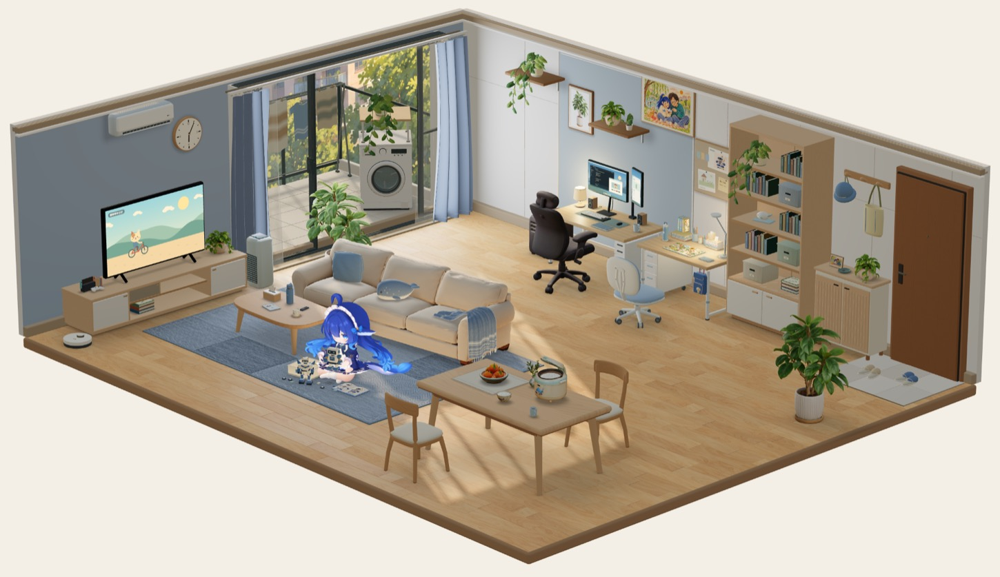

# Agent Home

**Agent 操作、人在浏览器里观看的 3D 小家。**

走动、坐下读书、上床睡觉、调整家具与墙纸；通过位置、朝向、动作回执和角色视角图片知道家里发生了什么。不绑定模型服务，不接 DSH/QQ。



## 启动

默认需要 **Node.js 22.12+ 和已有的 Chrome/Chromium**，不用安装 npm 依赖：

```sh
node start.mjs
```

在 WSL 内启动后，可在 Windows 浏览器打开 **http://localhost:19130/**。默认后台 Runner 执行动作，关掉观看页也能走动和截图。只需要原可见页模式可用 `node start.mjs --no-runner`。见 [Runner 与性能日志](docs/RUNNER.md)。不用 Python、`npm install`、Blender 或本地构建。网页和后端已经构建在 `runtime/`；第三方前端代码随网页产物包含，后端只使用 Node 内置模块，SQLite 也不需要下载原生依赖。

Node 22.12 所需的 SQLite 启动参数由入口自动处理。某些 Node 版本会显示官方实验性模块提示；不是缺少安装包。

- 首次运行创建 `house3d/data/house.sqlite`；已有 Python 版 SQLite 存档可继续读取，不会自动重置。
- 默认只监听本机。启动前确认端口没有旧服务，不自动停止其他实例。
- 更新时先正常停止旧服务并备份自己的存档，不用运行包覆盖/删除 `house3d/data/`。
- `/` 和 `/wander.html` 都是当前生活画布。

> 零安装运行方式适用于本地 Node 运行包或包含预构建 `runtime/` 的检出版本。旧的 Python 版本不能直接使用这个入口。

## Agent 怎么操作

同样不需要安装依赖：

```sh
node agent.mjs get_tools
node agent.mjs get_catalog
node agent.mjs get_presets
node agent.mjs observe_home
node agent.mjs list_interactions
node agent.mjs apply_preset '{"preset_id":"family-home","dry_run":true}'
node agent.mjs apply_preset '{"preset_id":"family-home","dry_run":false}'
```

`GET /api/tool-schemas` 返回 function schemas。接入方只需将工具名与参数转发给本地 HTTP 或上面的 CLI，不把任意自然语言当 shell。旧 API 路径、工具名、版本/幂等、SQLite 表结构和身体反馈协议保留。

## 当前能力

- **三套可编辑模板**：儿童房、和饲养员的家，以及带 111 件物品的「大肥鱼的连通小家」(`connected-home`)。应用模板会替换当前布置。想从儿童房走到客厅、家长卧室、浴室和阳台，可用 `connect_rooms` 先预览再接通，不必切模板。
- **119 个家具资产条目**：从目录选款式、批量增删/移动/旋转；桌面和层板摆件跟随父家具。条目包含挂高变体，并非全部都支持人物接触动作。
- **预演和校验**：dry-run 反馈越界、重叠、承载与近似可达性；正式应用有版本检查、幂等和原子保存。
- **可调整房间**：尺寸、墙色、墙纸；同步墙面、地面、导航、地图和全景镜头。
- **可进入的阳台**：家庭模板附带 3.6×2 米阳台，绿植、洗衣机、晾衣架独立可摆；真实门口通行、护栏边界、堵路预演与区域反馈。
- **身体动作**：避障走跑走、餐椅/办公椅就座、沙发坐卧与盖毯打盹、书桌前阅读和蜡笔画、地毯上拼搭与收玩具、床上睡觉、拿水壶浇花和安全起身。受理不等于完成，要查匹配的 job 与新鲜身体反馈。
- **观察和截图**：位置、朝向、姿态、支撑、手中物、完成/受阻原因及真实角色视角 PNG。
- **浏览器优先**：单 Canvas；运行资产全部本地提供，不依赖生成模型的网站或账号。

原有人物、家具和贴图等 **56 个运行资产 SHA256 与完整本机工程一致**，没有减面、缩图或重新编码。新增电视背景复用了完整本机工程已有的庭院插画；新增窗框/阳台是运行时网格，不重烘焙原模型。运行包仍低于 100 MB。家庭模板按实际布置加载家具，不会打开页面就加载全部目录。

## 文档

- [北京朝阳的窗外](docs/OUTDOORS.md)：北京时间、天气来源、独立预设和离线行为。
- [开发性能基线](docs/PERFORMANCE_BASELINE.md)：真实浏览器、隔离存档、耗时与绘制预算。

- [Agent 操作指南](docs/AGENT_GUIDE.md)：布置预演、异步动作、截图、并发和重试。
- [三人餐桌预演](docs/examples/family-supper.json)：在家庭模板里试放第三把餐椅，保留进出阳台的路线。
- [架构与运行边界](docs/ARCHITECTURE.md)：TS/Node、SQLite、浏览器执行和安全。
- [素材及许可](docs/ASSETS.md)：原始画质、来源和本地完整归档。
- [双桌精修](docs/DESKS.md)：两套桌架、独立桌面摆件与能力边界。
- [阳台操作与边界](docs/BALCONY.md)：走入阳台、独立摆件、推拉门和预演。
- [窗户与屏幕细节](docs/VISUAL_DETAILS.md)：实体近景、远景贴图和装饰能力边界。
- [Node 迁移验收](docs/NODE_MIGRATION.md)：契约、旧存档、零依赖运行验证。
- [开发入口](house3d/README.md)：只在修改源码时才需要的构建和测试。

## 还未完成

独立换装/换发型、通用抓取、进食动画、任意家具自动坐卧、多房间/多人、社区内容包导入、公网认证和 DSH 对接均未完成。

角色保留既有参考服装与专用修复，不代表通用角色/换装系统已经交付。没有实体手机、服务器/WSL 资源或长期性能验收。

## 开发与发布

**下面仅面向开发者；运行产物不需要这些步骤。**

```sh
npm ci --registry=https://registry.npmjs.org
npm run typecheck
npm run build
npm run package
npm test
npm run check:release
```

TS 后端源码在 `house3d/server/`；浏览器渲染代码继续在 `house3d/web/`。发布时统一构建后交付 `runtime/` 和模型，不让每个使用 Agent 重新构建。`npm run package` 生成不含依赖目录、源码构建工具、凭据和数据库的 Node 运行 ZIP。

## 来源

本项目从 [Star Office UI](https://github.com/ringhyacinth/Star-Office-UI) 的原型研究起步，当前运行代码独立于旧办公室后端；来源及原许可保留在 [LICENSE](LICENSE)、[UPSTREAM.md](UPSTREAM.md)。Three.js 声明在 [licenses/THREE-LICENSE.txt](licenses/THREE-LICENSE.txt)。

代码许可不等于美术许可。角色参考链含署名、非商业、相同方式共享等义务，AI 生成不清除这些权利。请读 [素材及许可](docs/ASSETS.md)，不宣称上游美术无条件原创或可任意商用。

完整 Blender 工程、原始素材、历史模型与最初完整提交仍保留在本机相邻 `dafeiyu-home`；本次迁移没有改动原项目或它的运行服务。
